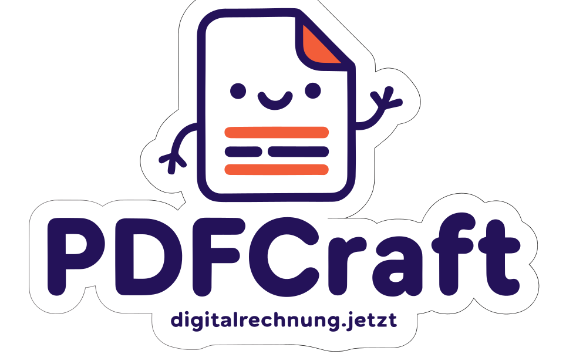

<p align="center">
  
</p>

# PDFCraft — Visual PDF Template Builder

[](LICENSE)
[](https://www.rust-lang.org/)
[](https://www.typescriptlang.org/)

A full-stack **PDF Template Builder** that combines simple form-based configurators for business documents (invoice, credit note, offer, order confirmation, delivery note, letter) in the browser with a blazing-fast Rust backend. Fill in your data and compile it on fixed templates to publication-quality PDFs via Typst — with no local Typst installation required.

**Live demo:** [digitalrechnung.jetzt](https://digitalrechnung.jetzt) — try the [document configurator](https://digitalrechnung.jetzt/app/) without a local installation. Please use sample data only.

## Features

- 🗂️ **Dashboard with document types** — invoice, credit note (Stornorechnung), offer, order confirmation, delivery note and letter (laid out after DIN 5008 Form B: fold and punch marks, address window, margins); each has its own Typst template and form, sender data and design are shared; issued documents are archived in the browser (`localStorage`, form data and the sender/design snapshot (no logo, no PDFs); one-file backup/restore (`pdfcraft-backup-<date>.json`, page "Daten & Sicherung", with a reminder on the dashboard); own page "Meine Belege"; cancel an invoice, create follow-up documents, bulk ZIP download); the UI is available in German and English (PDF language is a separate setting); credit notes can carry a ZUGFeRD/XRechnung XML (TypeCode 381)
- 🧾 **Form-based invoice configurator** — fill in invoice, recipient and line items; settings cover logo, company address, bank details, accent color, font, footer and texts
- 🖼️ **Logo upload** (PNG/JPG/SVG, ≤ 300 KB) sent to the backend as a base64 asset
- 💾 **Persistence** — settings and invoice draft are auto-saved in the browser (`localStorage`, versioned `schemaVersion`); export/import as JSON, reset to defaults
- 🎨 **Branded UI** — PDFCraft logo, favicon set and a modern landing page and configurator design (brand colors navy/orange/violet)
- 🌙 **Dark mode** — follows the browser/OS setting (`prefers-color-scheme`); the configurator header has a toggle that is remembered in `localStorage` (`pdfcraft.theme`); the landing page follows the system setting
- 👀 **Live PDF preview** — debounced re-render via the backend, shown in an iframe
- 📐 **Typst-quality PDF output** via `typst-as-lib` + `typst-pdf` — no local Typst installation needed
- 💉 **Data injection** via [minijinja](https://docs.rs/minijinja/) templating at render time
- ⚡ **Fast PDFs** — a lean Typst template and a Rust-generated Factur-X/XRechnung XML render an invoice in under 10 ms
- 📦 **Vendored Typst packages** — the few packages used (EPC QR code) ship in the repo; no network access at runtime
- ✉️ **Deutsche Post stamps (optional)** — buy an Internetmarke with your own Portokasse account and print the franking mark into the address field; stateless, nothing is stored on the server (off by default, see [guide](docs/14-internetmarke-integration.md))
- 🧾 **ZUGFeRD / Factur-X and XRechnung** — PDF/A-3b output with embedded EN 16931 or XRechnung XML (validated with Mustang), plus a sidebar that flags missing mandatory data

## Quick Start

Requires [Node.js](https://nodejs.org/) 18+ and [Rust](https://www.rust-lang.org/tools/install) 1.75+.

```bash
git clone https://github.com/maltinapro/pdfcraft.git && cd pdfcraft

# Terminal 1: backend on http://localhost:3000 (first build takes a few minutes)
cd backend && cargo run

# Terminal 2: frontend on http://localhost:5173 (landing page; the app is at /app/)
cd frontend && npm install && npm run dev
```

Or with Docker: `docker compose up --build` (landing page http://localhost:8080, app http://localhost:8080/app/, backend http://localhost:3000).

Open the frontend, fill in **Settings** and **Invoice**, and download the PDF. Input is saved in the browser; use **Exportieren / Importieren** for a JSON backup. The UI fetches a short-lived free token itself (Anubis challenge, PDFs carry an "Entwurf" watermark).

## Architecture

```
Browser form ──POST /v1/invoices (free token)──> Rust / Axum ── minijinja ── Typst ──> PDF/A-3b (+ ZUGFeRD XML)
Customer system ──POST /v1/invoices (purchased token)──> same engine, no watermark
```

Details: [Architecture and Extending](docs/10-architecture-and-extending.md).

## API at a glance

| Endpoint | Auth | Purpose |
| --- | --- | --- |
| `POST /v1/free-token` | Anubis pass | Free token for the demo frontend |
| `POST /v1/invoices` | token | One invoice → PDF |
| `POST /v1/invoices/bulk` | token | Many invoices → ZIP |
| `POST /v1/documents` | token | Credit note, offer, order confirmation, delivery note or letter → PDF |
| `POST /v1/documents/bulk` | token | Many documents of one type → ZIP |
| `GET /v1/postage/products`, `POST /v1/postage/stamps`, `POST /v1/postage/stamps/bulk` | token | Deutsche Post stamps (optional, off by default) |
| `GET /health` | none | Status |

```bash
curl -X POST http://localhost:3000/v1/invoices \
  -H 'Authorization: Bearer <key>' -H 'content-type: application/json' \
  --data @pdfcraft-config.json -o invoice.pdf
```

Full reference: [API Reference](docs/09-api-reference.md).

## Documentation

| Guide | Content |
| --- | --- |
| [Overview and Run Modes](docs/01-overview-and-modes.md) | Components and modes (dev, demo, production) |
| [Local Development](docs/02-local-development.md) | Run and test from source |
| [Docker (Local)](docs/03-docker-local.md) | Compose, Valkey |
| [Configuration](docs/04-configuration.md) | All environment variables |
| [Tokens and Rate Limiting](docs/05-tokens-and-rate-limiting.md) | Issue and manage customer keys |
| [Production](docs/06-production.md) | Deploying the `/v1` API |
| [Demo System](docs/07-demo-system.md) | Showing the configurator to prospects |
| [Kubernetes / Helm](docs/08-kubernetes-helm-outlook.md) | Demo chart in `deploy/helm/pdfcraft`; production chart planned |
| [API Reference](docs/09-api-reference.md) | Endpoints, bodies, examples |
| [Architecture and Extending](docs/10-architecture-and-extending.md) | Structure, how it works, adding fields |
| [Free Token and Anubis](docs/11-free-token-and-anubis.md) | Free tokens, Anubis, watermark |
| [Purchased Tokens (Stripe)](docs/12-paid-tokens-stripe.md) | Feature flag, Stripe webhook, renewal |
| [Observability](docs/13-observability.md) | JSON logs for Loki, Prometheus metrics, Grafana dashboards |
| [Internetmarke](docs/14-internetmarke-integration.md) | Buying Deutsche Post stamps and printing them onto PDFs |

## Tech Stack

React + Vite, Rust + Axum, minijinja, Typst (`typst-as-lib`, `typst-pdf`), Valkey.

## License

PDFCraft is MIT-licensed. The vendored Typst packages keep their own licenses (see `backend/vendor/typst-packages/**/LICENSE`).

MIT © 2026 PDFCraft contributors
